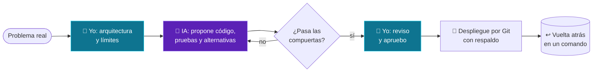

  

  

  
  
  
  

---

## 🧭 Cómo trabajo con IA (y dónde NO la dejo decidir)

No uso la IA para "hacer más código". La uso como un equipo rápido que yo dirijo. Cada cambio pasa por el mismo circuito:

| 🤖 Delego a la IA | 👤 Nunca lo delego |
|---|---|
| Borradores de código, pruebas y refactors | La **arquitectura** y las fronteras del dominio |
| Revisión estática (Semgrep) y búsqueda en documentación | **Seguridad**: autenticación, roles, secretos, cifrado |
| Pruebas de interfaz automatizadas con navegador | Qué se despliega y cuándo (**producción la lanzo yo**) |
| Tareas repetitivas con flujos y agentes | Aceptar un resultado sin entenderlo |

> **Regla de oro:** el código que no puedo explicar no entra, lo haya escrito yo o un modelo.

---

## 🛠️ Mi banco de trabajo con agentes

Configuro y estudio herramientas para que la IA trabaje con memoria, control y trazabilidad:

- **Claude Code** con servidores **MCP** (Semgrep, documentación en vivo, Playwright, pruebas automáticas) y atajos de un solo comando para Docker y despliegues.
- Repositorios de agentes y *skills* que estudio y adapto: [`agent-skill-creator`](https://github.com/PabloTwoElf/agent-skill-creatorClaudeSkill) · [`napkin`](https://github.com/PabloTwoElf/napkinClaudeSkill) (memoria de errores por repo) · [`token-optimizer`](https://github.com/PabloTwoElf/token-optimizerClaudeSkill) · [`humanizer`](https://github.com/PabloTwoElf/humanizerClaudeSkill) · [`strix`](https://github.com/PabloTwoElf/strixPablo) (pruebas de penetración con IA) · [`Mokagency-agents`](https://github.com/PabloTwoElf/Mokagency-agents)
- Automatización con **n8n** y voz con **Retell AI**.

---

## 🚀 Proyectos con decisiones que puedes leer

<table>
<tr>
<td width="50%" valign="top">

### 🚌 [CulturalTrip](https://github.com/PabloTwoElf/apiconsumidorac)
Compra de pasajes de bus con selección de asientos y pago.

- Asientos con **bloqueo temporal** que pasa a reserva solo tras cobrar
- Pago con **PayPal Sandbox** orquestado por la API
- **Hexagonal + MVC**, función serverless en Vercel
- Diagnóstico documentado de **6 causas** de un `404` en producción

  

</td>
<td width="50%" valign="top">

### 🔐 [SSO + Keycloak + 2FA](https://github.com/PabloTwoElf/SoftwareSegurokeyCloack)
Dos sistemas independientes con una sola identidad.

- **SSO** y roles centralizados con Keycloak
- Doble factor **TOTP**
- Canal de datos **cifrado entre sistemas**
- APIs en **.NET 8**, frontends React, todo en Docker

  

</td>
</tr>
<tr>
<td width="50%" valign="top">

### 🛡️ [ClickLoker + Auth](https://github.com/PabloTwoElf/DesarolloDelSoftwareSeguroAppApuestas)
Autenticación JWT reutilizable y seguimiento de clics.

- Repository Pattern, capa de servicios e inyección de dependencias
- **RLS en Supabase**, Redis, limitación de peticiones
- Levanta con `docker compose up --build`

 

</td>
<td width="50%" valign="top">

### 📡 [MirrorView](https://github.com/PabloTwoElf/MirrorView)
Reflejo de pantallas entre dispositivos.

- **WebRTC** con servidor de señalización propio
- Frontend en GitHub Pages, señalización en Render

 

</td>
</tr>
</table>

---

## 🧰 Stack

  

Arquitectura hexagonal · SOLID · Microservicios · Keycloak · JWT · n8n · Retell AI · LLMs y agentes

---

## 📊 En números

  
  

  

  

